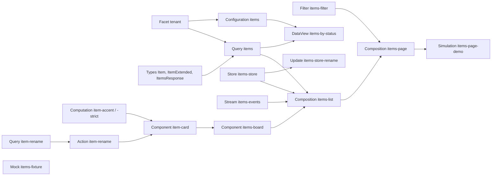

# Вертикальный срез: от модели до экрана

Руководство показывает один связанный workspace, в котором участвуют почти все типы документов, и объясняет, **когда** каждый из них нужен, а когда лишний. Пример абстрактный: список записей `Item` с двумя тенантами. У тенанта B другой адрес API, расширенный тип записи, свой заголовок и более строгое правило акцента.

Пример проверен целиком:

- все 23 тела ниже созданы на Service Backend 0.17.0 (`AUTH_MODE=dev`) и закоммичены;
- snapshot `GET /api/v1/domain` скомпилирован `@endge/core` 1.0.0-dev.11 тем же путём, что в Configurator, для контекстов `tenant-a` и `tenant-b`: 0 ошибок, 0 предупреждений;
- Composition `items-page` смонтирована runtime Core в режиме mock для обоих тенантов: заголовок берётся из Configuration тенанта (`Записи` / `Записи тенанта B`), Query выбирает путь `/items` / `/v2/items`, runtime problems нет.

Блок `json [POST …]` — точное тело запроса создания; Source в нём совпадает с блоком кода над ним. Минимальные примеры каждого типа по отдельности — на странице [примеров документов](/agents/document-examples).

## Карта связей



Стрелка «A → B» означает «B ссылается на A». Компилятор проверяет каждую такую ссылку: существование identity, kind, активность, контракт порта, output или события.

## Таблица решений

| Вопрос | Выбирайте | Когда | Когда не нужно |
| --- | --- | --- | --- |
| Где держать данные запроса | **Output Query** (`fromOutput`) | Один потребитель показывает ответ как есть; данные живут, пока смонтирован runtime | — |
| | **Store** (`.storeTo`, `fromData`) | Данные читают несколько runtime; их меняют события, Stream или Update; нужны derived-поля | Если единственный компонент только показывает ответ: Store добавит документ и Update без пользы |
| Преобразование формы данных | **DataView** | Фильтр, сортировка, группировка, проекция, join; переиспользуется несколькими Query или Store | Для одного значения или решения «да/нет» — это Computation |
| | **Computation** | Вычисленное значение или решение: цвет, статус, доступность; граф outputs, `typescript` в песочнице; вызывается портом компонента или из Action | Для перестройки коллекции — DataView |
| | **Выражение в template** | Тривиальное форматирование одного значения (`props.title.toUpperCase()`) | Если правило нужно где-то ещё или зависит от тенанта — вынесите в Computation и подключите портом |
| Изменение состояния | **`.mutate(...)`** в `onEvent` | Одно локальное изменение Store по событию | Несколько полей, повторное использование или `handles` |
| | **Update** | Именованное изменение одного Store: несколько mutations, `handles` для Stream и событий | Сервер Update не вызывает |
| | **Action** | Последовательность эффектов: Query, Computation, конвертация; результат или ошибка; вызов сервера | Для чистой записи в Store без сервера |
| Заменяемая часть интерфейса | **Порт `require: component<Props>(…)`** | Дочерний компонент нужно подменять без правки родителя: на месте вызова (`:card="component('…')"`) или по тенанту (`contextSwitch`) | Если меняются только данные — prop |
| | **Prop** | Данные для отображения | Не передавайте через prop identity документа для «ручного» выбора поведения — для этого порты |
| Слоты Vue (`<slot>`) | **Нет в Component SFC** | Аналог слота — порт `component` с локальным тегом | — |
| Сколько Composition | **Одна** | Страница из нескольких runtime без повторного использования | — |
| | **Несколько** (`kind: 'library'` + `composition('…').withProps`) | Блок переиспользуется на нескольких страницах, имеет свой контракт `defineProps`, свои hooks и Store; страницу собирают из блоков | Если вложенная Composition используется один раз и не имеет своего контракта — лишний уровень |
| Различие тенантов в данных | **`contextSwitch` в Source** | Ветка значения: путь, тип контракта, провайдер порта, runtime | Если отличается только значение настройки — Configuration и patch документа фасета |
| | **Configuration + документ фасета** | Текст, числа, списки, флаги, которые меняет администратор тенанта | Если меняется логика или структура — `contextSwitch` |
| | **`enabledWhen(context({…}))`** | Runtime или scope есть только у части тенантов | Если элемент есть у всех, но различается — `contextSwitch` |
| | **Порт с `contextSwitch`** | У тенанта другой провайдер того же контракта (Computation, Query, Action, Component) | Если различается только число или текст — Configuration |
| Подмена данных | **Inline `mock` Query** (`enabled: true`) | Небольшой ответ одного Query без сервера в режиме `live`, например пока API недоступно | В режиме `mock` (Query там не выполняется) и когда данные нужны нескольким документам |
| | **Mock-документ** | Fixture переиспользуется: Store initializer, Vocab, preview props | Для генерации больших наборов — Simulation |
| | **Simulation** | Проверить Composition на сгенерированных данных (`mockRequest`, `mockStream`), не меняя её | Simulation не создаёт aliases и не меняет props и Store |

## Порядок создания и коммита

Backend принимает документы в любом порядке: ссылки разрешает компилятор, а не backend. Создавайте от зависимостей к потребителям, иначе промежуточные состояния не компилируются, а план коммита содержит сломанные ревизии:

1. Фасет и его документы.
2. Types, Configuration.
3. Filter, Query, Stream.
4. Store, затем Update со `storeIdentity`.
5. DataView, Computation, Action.
6. Компоненты: сначала дочерний `item-card`, затем `items-board`.
7. Composition: сначала вложенная `items-list`, затем страница `items-page`.
8. Mock, Simulation.
9. Проверка компиляцией всего workspace (ниже), затем `POST /api/v1/commits/plan` и коммит по просьбе пользователя.

## 1. Фасет и Configuration

Фасет `tenant` — ось контекста сборки. Документ фасета `tenant-b` меняет значение `items.title` патчем: логика не меняется, поэтому `contextSwitch` здесь не нужен.

`POST /api/v1/facets`:

```json [POST /api/v1/facets]
{
  "identity": "tenant",
  "displayName": "Тенант",
  "icon": "Building",
  "color": "#2563eb"
}
```

`POST /api/v1/facets/tenant/documents`:

```json [POST /api/v1/facets/tenant/documents]
{
  "identity": "tenant-a",
  "displayName": "Тенант A",
  "configuration": {
    "mode": "inherit",
    "patch": {}
  }
}
```

`POST /api/v1/facets/tenant/documents`:

```json [POST /api/v1/facets/tenant/documents]
{
  "identity": "tenant-b",
  "displayName": "Тенант B",
  "configuration": {
    "mode": "inherit",
    "patch": {
      "values": {
        "items": {
          "title": {
            "op": "set",
            "value": "Записи тенанта B"
          }
        }
      }
    }
  }
}
```

Configuration объявляет значения по умолчанию. Identity `items` — пространство имён: значение читается как `config('items.title')`.

```ts
defineConfig({
  title: value(String, 'Записи').label('Заголовок'),
  pageSize: value(Number, 50).label('Размер страницы').min(10).max(200),
})
```

`POST /api/v1/configurations`:

```json [POST /api/v1/configurations]
{
  "identity": "items",
  "displayName": "Настройки записей",
  "sourceVersion": 1,
  "source": "defineConfig({\n  title: value(String, 'Записи').label('Заголовок'),\n  pageSize: value(Number, 50).label('Размер страницы').min(10).max(200),\n})"
}
```

## 2. Types

`ItemExtended` расширяет `Item` полем тенанта B. `ItemsResponse` описывает корневой ответ: без него Simulation не знает пути массивов. Внутри Type ссылка пишется `type('Item')`, список — `arrayOf(...)`; в контрактах Query, Store и props — строкой: `field('Item').array()`.

```ts
defineType({
  id: field(String),
  title: field(String),
  status: field(String),
  priority: field(Number),
})
```

`POST /api/v1/types`:

```json [POST /api/v1/types]
{
  "identity": "Item",
  "displayName": "Запись",
  "sourceVersion": 1,
  "source": "defineType({\n  id: field(String),\n  title: field(String),\n  status: field(String),\n  priority: field(Number),\n})"
}
```

```ts
defineType({
  extends: type('Item'),
  fields: {
    region: field(String),
  },
})
```

`POST /api/v1/types`:

```json [POST /api/v1/types]
{
  "identity": "ItemExtended",
  "displayName": "Запись тенанта B",
  "sourceVersion": 1,
  "source": "defineType({\n  extends: type('Item'),\n  fields: {\n    region: field(String),\n  },\n})"
}
```

```ts
defineType({
  items: field(arrayOf(type('Item'))),
  total: field(Number),
})
```

`POST /api/v1/types`:

```json [POST /api/v1/types]
{
  "identity": "ItemsResponse",
  "displayName": "Ответ списка записей",
  "sourceVersion": 1,
  "source": "defineType({\n  items: field(arrayOf(type('Item'))),\n  total: field(Number),\n})"
}
```

## 3. Filter и Query

Filter хранит выбор пользователя и публикует output `request`. Его подключает страница и передаёт во вложенную Composition как prop.

```ts
defineFilter({
  fields: {
    status: field('String').optional(),
  },
  outputs: {
    request: output().json(({ value }) => compact({
      status: value('status'),
    })),
  },
})
```

`POST /api/v1/filters`:

```json [POST /api/v1/filters]
{
  "identity": "items-filter",
  "displayName": "Фильтр записей",
  "sourceVersion": 1,
  "source": "defineFilter({\n  fields: {\n    status: field('String').optional(),\n  },\n  outputs: {\n    request: output().json(({ value }) => compact({\n      status: value('status'),\n    })),\n  },\n})"
}
```

Query `items` — сложный случай:

- `props` с `filter` и значением по умолчанию `limit`;
- путь и тип контракта выбираются `contextSwitch` по тенанту, заголовок `X-Tenant` — `facet('tenant')`;
- outputs упорядочены: `groups` строится из `items` через DataView;
- `response` с контрактом всего ответа нужен Simulation;
- inline `mock` (`enabled: true`) даёт данные без сервера в режиме `live`. В режиме `mock` Query не выполняется: данные для него даёт Simulation (раздел 8).

```ts
defineQuery({
  kind: 'rest',
  props: defineProps({
    filter: field('Object').optional(),
    limit: field('Number').default(50),
  }),
  request: {
    endpoint: 'https://api.example.test',
    path: contextSwitch({
      default: '/items',
      cases: [{ when: { tenant: 'tenant-b' }, use: '/v2/items' }],
    }),
    method: 'POST',
    headers: { 'X-Tenant': facet('tenant') },
    body: body(({ prop }) => merge({ limit: prop('limit') }, prop('filter'))),
  },
  outputs: {
    response: output().from(response()).contract(field('ItemsResponse')),
    items: output().from(response('items')).contract(field(contextSwitch({
      default: 'Item',
      cases: [{ when: { tenant: 'tenant-b' }, use: type('ItemExtended') }],
    })).array()),
    groups: output().from('items').dataView('items-by-status'),
  },
  mock: {
    enabled: true,
    data: {
      items: [
        { id: 'item-1', title: 'Первая', status: 'new', priority: 2, region: 'north' },
        { id: 'item-2', title: 'Вторая', status: 'done', priority: 1, region: 'south' },
      ],
      total: 2,
    },
  },
})
```

`POST /api/v1/queries`:

```json [POST /api/v1/queries]
{
  "identity": "items",
  "displayName": "Список записей",
  "sourceVersion": 2,
  "source": "defineQuery({\n  kind: 'rest',\n  props: defineProps({\n    filter: field('Object').optional(),\n    limit: field('Number').default(50),\n  }),\n  request: {\n    endpoint: 'https://api.example.test',\n    path: contextSwitch({\n      default: '/items',\n      cases: [{ when: { tenant: 'tenant-b' }, use: '/v2/items' }],\n    }),\n    method: 'POST',\n    headers: { 'X-Tenant': facet('tenant') },\n    body: body(({ prop }) => merge({ limit: prop('limit') }, prop('filter'))),\n  },\n  outputs: {\n    response: output().from(response()).contract(field('ItemsResponse')),\n    items: output().from(response('items')).contract(field(contextSwitch({\n      default: 'Item',\n      cases: [{ when: { tenant: 'tenant-b' }, use: type('ItemExtended') }],\n    })).array()),\n    groups: output().from('items').dataView('items-by-status'),\n  },\n  mock: {\n    enabled: true,\n    data: {\n      items: [\n        { id: 'item-1', title: 'Первая', status: 'new', priority: 2, region: 'north' },\n        { id: 'item-2', title: 'Вторая', status: 'done', priority: 1, region: 'south' },\n      ],\n      total: 2,\n    },\n  },\n})"
}
```

Второй Query пишет на сервер. Его вызывает Action, а не компонент напрямую: так провайдер можно заменить, не меняя компонент.

```ts
defineQuery({
  kind: 'rest',
  props: defineProps({
    id: field('String'),
    title: field('String'),
  }),
  request: {
    endpoint: 'https://api.example.test',
    path: '/items/rename',
    method: 'POST',
    headers: { 'X-Tenant': facet('tenant') },
    body: body(({ prop }) => ({ id: prop('id'), title: prop('title') })),
  },
  outputs: {
    item: output().from(response('item')).contract(field('Item')),
  },
})
```

`POST /api/v1/queries`:

```json [POST /api/v1/queries]
{
  "identity": "item-rename",
  "displayName": "Переименовать запись",
  "sourceVersion": 2,
  "source": "defineQuery({\n  kind: 'rest',\n  props: defineProps({\n    id: field('String'),\n    title: field('String'),\n  }),\n  request: {\n    endpoint: 'https://api.example.test',\n    path: '/items/rename',\n    method: 'POST',\n    headers: { 'X-Tenant': facet('tenant') },\n    body: body(({ prop }) => ({ id: prop('id'), title: prop('title') })),\n  },\n  outputs: {\n    item: output().from(response('item')).contract(field('Item')),\n  },\n})"
}
```

Stream принимает события сервера. Composition направит их в Store, Store сопоставит `type` события с `handles` своих Update.

```ts
defineStream({
  transport: sse({
    url: 'https://api.example.test/items/events',
    withCredentials: false,
    auth: 'inherit',
  }),
  events: {
    message: event({
      typeFrom: 'type',
      payloadFrom: 'payload',
    }),
  },
})
```

`POST /api/v1/streams`:

```json [POST /api/v1/streams]
{
  "identity": "items-events",
  "displayName": "События записей",
  "sourceVersion": 1,
  "source": "defineStream({\n  transport: sse({\n    url: 'https://api.example.test/items/events',\n    withCredentials: false,\n    auth: 'inherit',\n  }),\n  events: {\n    message: event({\n      typeFrom: 'type',\n      payloadFrom: 'payload',\n    }),\n  },\n})"
}
```

## 4. Store и Update

Store — общее состояние вложенной Composition. `urgent` — derived-поле: писать в него нельзя, компилятор отклонит такую mutation (`store-update-target-invalid`).

```ts
defineStore({
  data: {
    items: value([]).contract(field('Item').array()),
    lastOpenedAt: value(null),
    urgent: derived()
      .from('items')
      .select(path('').where(match({ priority: 2 })))
      .contract(field('Item').array()),
  },
})
```

`POST /api/v1/stores`:

```json [POST /api/v1/stores]
{
  "identity": "items-store",
  "displayName": "Состояние записей",
  "sourceVersion": 1,
  "source": "defineStore({\n  data: {\n    items: value([]).contract(field('Item').array()),\n    lastOpenedAt: value(null),\n    urgent: derived()\n      .from('items')\n      .select(path('').where(match({ priority: 2 })))\n      .contract(field('Item').array()),\n  },\n})"
}
```

Update принадлежит Store через поле тела `storeIdentity` и обрабатывает событие `item.renamed` из Stream.

```ts
defineUpdate({
  handles: ['item.renamed'],
  mutations: [
    {
      strategy: 'merge',
      target: 'items[id=$id]',
      ifExists: 'items[id=$id]',
      valueFrom: 'patch',
      vars: { id: 'id' },
    },
  ],
})
```

`POST /api/v1/updates`:

```json [POST /api/v1/updates]
{
  "identity": "items-store-rename",
  "displayName": "Переименование в Store",
  "storeIdentity": "items-store",
  "sourceVersion": 1,
  "source": "defineUpdate({\n  handles: ['item.renamed'],\n  mutations: [\n    {\n      strategy: 'merge',\n      target: 'items[id=$id]',\n      ifExists: 'items[id=$id]',\n      valueFrom: 'patch',\n      vars: { id: 'id' },\n    },\n  ],\n})"
}
```

## 5. DataView, Computation, Action

DataView читает контекст сборки: `facet('tenant')` и `config('items.title')`. Сортировка и группировка — `sortByDesc`, `groupBy`.

```ts
defineDataView({
  mode: 'projection',
  output: {
    tenant: facet('tenant'),
    title: config('items.title'),
    byPriority: path('').sortByDesc(get('priority')),
    byStatus: path('').groupBy(get('status')),
  },
})
```

`POST /api/v1/data-views`:

```json [POST /api/v1/data-views]
{
  "identity": "items-by-status",
  "displayName": "Записи по статусам",
  "sourceVersion": 1,
  "source": "defineDataView({\n  mode: 'projection',\n  output: {\n    tenant: facet('tenant'),\n    title: config('items.title'),\n    byPriority: path('').sortByDesc(get('priority')),\n    byStatus: path('').groupBy(get('status')),\n  },\n})"
}
```

Две Computation с одинаковым контрактом. Компонент выберет одну из них портом по тенанту.

```ts
defineComputation({
  outputs: {
    urgent: eq(input('priority'), 2),
    tone: when(output('urgent'), 'warning', 'info'),
  },
  result: output('tone'),
})
```

`POST /api/v1/computations`:

```json [POST /api/v1/computations]
{
  "identity": "item-accent",
  "displayName": "Акцент записи",
  "sourceVersion": 1,
  "contractVersion": 1,
  "source": "defineComputation({\n  outputs: {\n    urgent: eq(input('priority'), 2),\n    tone: when(output('urgent'), 'warning', 'info'),\n  },\n  result: output('tone'),\n})"
}
```

```ts
defineComputation({
  outputs: {
    tone: when(gt(input('priority'), 0), 'danger', 'info'),
  },
  result: output('tone'),
})
```

`POST /api/v1/computations`:

```json [POST /api/v1/computations]
{
  "identity": "item-accent-strict",
  "displayName": "Акцент записи (строгий)",
  "sourceVersion": 1,
  "contractVersion": 1,
  "source": "defineComputation({\n  outputs: {\n    tone: when(gt(input('priority'), 0), 'danger', 'info'),\n  },\n  result: output('tone'),\n})"
}
```

Action — последовательность шагов: нормализует ввод и вызывает Query.

```ts
defineAction({
  contract: {
    input: field('Object'),
    output: field('Object'),
  },
  steps: {
    title: input('title').trim(),
    save: query({
      identity: 'item-rename',
      input: { id: input('id'), title: output('title') },
    }),
  },
  output: {
    item: output('save'),
  },
})
```

`POST /api/v1/actions`:

```json [POST /api/v1/actions]
{
  "identity": "item-rename",
  "displayName": "Переименовать запись",
  "sourceVersion": 1,
  "source": "defineAction({\n  contract: {\n    input: field('Object'),\n    output: field('Object'),\n  },\n  steps: {\n    title: input('title').trim(),\n    save: query({\n      identity: 'item-rename',\n      input: { id: input('id'), title: output('title') },\n    }),\n  },\n  output: {\n    item: output('save'),\n  },\n})"
}
```

## 6. Компоненты: props, порты и подмена по контексту

`item-card` получает данные через prop `item` и зависит от внешнего мира только через порты:

- `require.accent` — Computation, по умолчанию `item-accent`;
- `require.rename` — Action, вызывается реакцией на `@edited`;
- `emits.opened` — публичное событие из клика по `Badge` (`from: { ref, event }`).

```vue
<script setup lang="ts">
interface Item {
  id: string
  title: string
  status: string
  priority: number
}

const props = defineProps<{ item: Item }>()

const ports = definePorts({
  require: {
    accent: computation<{ priority: number }, string>({ default: 'item-accent' }),
    rename: action<{ id: string, title: string }, unknown>({ default: 'item-rename' }),
  },
  emits: {
    opened: event<ComponentSFCPointerEventPayload>({
      from: { ref: 'status', event: 'click' },
    }),
  },
})

const accent = ports.require.accent({ priority: props.item.priority })
</script>

<template>
  <Flex row gap="2" align="center">
    <Badge ref="status" :tone="accent.value">{{ item.status }}</Badge>
    <Text
      :value="item.title"
      editable
      @edited="ports.require.rename({ id: item.id, title: event('value') })"
    />
  </Flex>
</template>
```

`POST /api/v1/components`:

```json [POST /api/v1/components]
{
  "identity": "item-card",
  "displayName": "Карточка записи",
  "modelVersion": 1,
  "source": "<script setup lang=\"ts\">\ninterface Item {\n  id: string\n  title: string\n  status: string\n  priority: number\n}\n\nconst props = defineProps<{ item: Item }>()\n\nconst ports = definePorts({\n  require: {\n    accent: computation<{ priority: number }, string>({ default: 'item-accent' }),\n    rename: action<{ id: string, title: string }, unknown>({ default: 'item-rename' }),\n  },\n  emits: {\n    opened: event<ComponentSFCPointerEventPayload>({\n      from: { ref: 'status', event: 'click' },\n    }),\n  },\n})\n\nconst accent = ports.require.accent({ priority: props.item.priority })\n</script>\n\n<template>\n  <Flex row gap=\"2\" align=\"center\">\n    <Badge ref=\"status\" :tone=\"accent.value\">{{ item.status }}</Badge>\n    <Text\n      :value=\"item.title\"\n      editable\n      @edited=\"ports.require.rename({ id: item.id, title: event('value') })\"\n    />\n  </Flex>\n</template>\n"
}
```

`items-board` объявляет порт `card` типа `component` с локальным тегом `Items.Card`. Это аналог слота: другой компонент с тем же контрактом props подставляется атрибутом `:card="component('…')"` на месте вызова доски. Для каждого экземпляра карточки провайдер порта `accent` выбирается по тенанту через `contextSwitch`: компилятор проверяет обе ветки, в artifact попадает выбранная. Событие `opened` карточки доска публикует наружу (`from: { ref: 'card', event: 'opened' }`).

```vue
<script setup lang="ts">
interface Item {
  id: string
  title: string
  status: string
  priority: number
}

interface CardProps {
  item: Item
}

defineProps<{ title: string, items: Item[] }>()

const ports = definePorts({
  require: {
    card: component<CardProps>({ tag: 'Items.Card', default: 'item-card' }),
  },
  emits: {
    opened: event<ComponentSFCPointerEventPayload>({
      from: { ref: 'card', event: 'opened' },
    }),
  },
})
</script>

<template>
  <Flex col gap="2">
    <Text weight="600">{{ title }}</Text>
    <Items.Card
      ref="card"
      for="item in items"
      :key="item.id"
      :item="item"
      :accent="contextSwitch({
        default: computation('item-accent'),
        cases: [{ when: { tenant: 'tenant-b' }, use: computation('item-accent-strict') }],
      })"
    />
  </Flex>
</template>
```

`POST /api/v1/components`:

```json [POST /api/v1/components]
{
  "identity": "items-board",
  "displayName": "Доска записей",
  "modelVersion": 1,
  "source": "<script setup lang=\"ts\">\ninterface Item {\n  id: string\n  title: string\n  status: string\n  priority: number\n}\n\ninterface CardProps {\n  item: Item\n}\n\ndefineProps<{ title: string, items: Item[] }>()\n\nconst ports = definePorts({\n  require: {\n    card: component<CardProps>({ tag: 'Items.Card', default: 'item-card' }),\n  },\n  emits: {\n    opened: event<ComponentSFCPointerEventPayload>({\n      from: { ref: 'card', event: 'opened' },\n    }),\n  },\n})\n</script>\n\n<template>\n  <Flex col gap=\"2\">\n    <Text weight=\"600\">{{ title }}</Text>\n    <Items.Card\n      ref=\"card\"\n      for=\"item in items\"\n      :key=\"item.id\"\n      :item=\"item\"\n      :accent=\"contextSwitch({\n        default: computation('item-accent'),\n        cases: [{ when: { tenant: 'tenant-b' }, use: computation('item-accent-strict') }],\n      })\"\n    />\n  </Flex>\n</template>\n"
}
```

## 7. Несколько Composition

`items-list` — переиспользуемый блок (`kind: 'library'`) со своим контрактом `defineProps`:

- `data` объявляет Store, `.storeTo` кладёт output Query в Store, компонент читает `fromData`;
- `stream(...).dispatchTo(data('items'))` направляет события Stream в Update по `handles`;
- hooks: запуск при монтировании, перезапуск при изменении prop `filter` с debounce, `onEvent(...).mutate(...)` — локальная запись по событию компонента;
- `outputs` публикует список наружу.

```ts
defineComposition({
  props: defineProps({
    filter: field('Object').optional(),
  }),
  data: {
    items: store('items-store'),
  },
  runtimes: {
    request: query('items')
      .withProps({ filter: prop('filter') })
      .storeTo(data('items'), { items: output('items') }),
    changes: stream('items-events').dispatchTo(data('items')),
    board: component('items-board').withProps({
      title: config('items.title'),
      items: fromData('items.items'),
    }),
  },
  hooks: [
    onMount().run('request'),
    onChange(prop('filter')).debounce(300).run('request'),
    onEvent('board', 'opened').mutate(data('items'), {
      strategy: 'set',
      path: 'lastOpenedAt',
      value: now(),
    }),
  ],
  outputs: {
    items: output().fromRuntime('request').select('items'),
  },
})
```

`POST /api/v1/compositions`:

```json [POST /api/v1/compositions]
{
  "identity": "items-list",
  "displayName": "Список записей (вложенная)",
  "kind": "library",
  "sourceVersion": 1,
  "source": "defineComposition({\n  props: defineProps({\n    filter: field('Object').optional(),\n  }),\n  data: {\n    items: store('items-store'),\n  },\n  runtimes: {\n    request: query('items')\n      .withProps({ filter: prop('filter') })\n      .storeTo(data('items'), { items: output('items') }),\n    changes: stream('items-events').dispatchTo(data('items')),\n    board: component('items-board').withProps({\n      title: config('items.title'),\n      items: fromData('items.items'),\n    }),\n  },\n  hooks: [\n    onMount().run('request'),\n    onChange(prop('filter')).debounce(300).run('request'),\n    onEvent('board', 'opened').mutate(data('items'), {\n      strategy: 'set',\n      path: 'lastOpenedAt',\n      value: now(),\n    }),\n  ],\n  outputs: {\n    items: output().fromRuntime('request').select('items'),\n  },\n})"
}
```

`items-page` — страница (`kind: 'workspace'`). Она связывает Filter с вложенной Composition через prop и добавляет scope, который есть только у тенанта B (`enabledWhen`).

```ts
defineComposition({
  activateOn: startup(),
  runtimes: {
    filters: filter('items-filter'),
    list: composition('items-list').withProps({
      filter: fromOutput('filters', 'request'),
    }),
    regionNote: scope({
      runtimes: {
        card: component('item-card').withProps({
          item: { id: 'note', title: 'Регион доступен', status: 'info', priority: 1 },
        }),
      },
    }).enabledWhen(context({ tenant: 'tenant-b' })),
  },
})
```

`POST /api/v1/compositions`:

```json [POST /api/v1/compositions]
{
  "identity": "items-page",
  "displayName": "Страница записей",
  "kind": "workspace",
  "sourceVersion": 1,
  "source": "defineComposition({\n  activateOn: startup(),\n  runtimes: {\n    filters: filter('items-filter'),\n    list: composition('items-list').withProps({\n      filter: fromOutput('filters', 'request'),\n    }),\n    regionNote: scope({\n      runtimes: {\n        card: component('item-card').withProps({\n          item: { id: 'note', title: 'Регион доступен', status: 'info', priority: 1 },\n        }),\n      },\n    }).enabledWhen(context({ tenant: 'tenant-b' })),\n  },\n})"
}
```

## 8. Mock и Simulation

Mock-документ — переиспользуемый fixture (например, для preview props или Store initializer). Simulation проверяет страницу на 50 сгенерированных записях: путь `list → request` повторяет aliases вложенных Composition, массив `items` берётся из контракта `ItemsResponse`.

`POST /api/v1/mocks`:

```json [POST /api/v1/mocks]
{
  "identity": "items-fixture",
  "displayName": "Записи для проверки",
  "contentSource": "document",
  "contentType": "application/json",
  "source": "{\"items\": [{\"id\": \"item-1\", \"title\": \"Первая\", \"status\": \"new\", \"priority\": 2}], \"total\": 1}"
}
```

```ts
defineSimulation({
  target: composition('items-page'),
  overrides: {
    runtimes: {
      list: {
        runtimes: {
          request: {
            request: mockRequest({ seed: 'items-demo', arrays: { items: 50 } }),
          },
        },
      },
    },
  },
})
```

`POST /api/v1/simulations`:

```json [POST /api/v1/simulations]
{
  "identity": "items-page-demo",
  "displayName": "Страница записей: 50 записей",
  "sourceVersion": 1,
  "source": "defineSimulation({\n  target: composition('items-page'),\n  overrides: {\n    runtimes: {\n      list: {\n        runtimes: {\n          request: {\n            request: mockRequest({ seed: 'items-demo', arrays: { items: 50 } }),\n          },\n        },\n      },\n    },\n  },\n})"
}
```

## Как проверять каждую связь

| Связь | Что проверяет компилятор | Код при ошибке |
| --- | --- | --- |
| Порт → провайдер | Существование, kind, активность, контракт | `sfc-port-default-missing`, `sfc-template-port-provider-missing` |
| Событие дочернего компонента → `emits.from` | Дочерний компонент публикует событие | `sfc-event-from-event-missing` |
| Реакция на событие тега | Только Action, `query({...})` или `typescript({...})`; во `typescript.inputs` — только `event(...)` | `sfc-event-action-shape`, `sfc-event-typescript-input` |
| `onEvent(alias, event)` | Runtime — компонент, событие объявлено в его `emits` | `composition-event-port-missing` |
| `.mutate` / Update → Store | Поле существует и writable | `composition-event-mutation-readonly`, `store-update-target-invalid` |
| Update → Store | `storeIdentity` указывает на Store | `update-store-owner-missing` |
| `fromOutput(alias, output)` | Output существует | `composition-binding-output-missing` |
| `onMount().run(alias)` | Цель — Query текущей Composition | `composition-hook-target-kind` |
| Composition → Composition | Нет цикла, вложенная компилируется | `composition-reference-cycle`, `composition-composition-invalid` |
| Stream → Store | `dispatchTo` указывает на объявленный alias | `composition-dispatch-to-data` |
| `filterView(runtime)` → Filter | Аргумент — имя Filter runtime этой Composition (ключ в `runtimes`), а не identity документа Filter | `composition-filter-fields-source-missing`, `composition-filter-fields-source-kind` |
| Action `update(...)` → Store | Не проверяется: ближайшая Composition вызывающего runtime должна объявить `store(...)` владельца Update | ошибка выполнения `Store "…" is not mounted` ([Action](/reference/action#шаги-typescript-и-update)) |
| Action → Query | Query существует | `action-query-missing` |
| Type → Type | `extends`, `type(...)` указывают на существующие Type | `type-reference-missing` |
| Simulation → Composition | Aliases существуют, у Query есть контракт ответа | `simulation-runtime-missing`, `simulation-response-contract` |

Компилятор 1.0.0-dev.11 **не** считает ошибкой лишний или недостающий prop при вызове компонента или вложенной Composition, `config('…')` без значения и условие по несуществующему документу фасета. Обращение в template к полю, которого нет в типе prop, не проверяется вовсе. Эти случаи сверяйте вручную; инструмент оценки репозитория документации (`scripts/grade-workspace.mjs`) ловит первые три.

Ошибка вложенного документа поднимается вверх по ссылкам: сломанная карточка даёт `composition-component-sfc-invalid` у Composition и `composition-composition-invalid` у страницы. Исправляйте **самый нижний** документ цепочки.

## Где смотреть результат

- **Агент с локальным Core** — компиляция всего snapshot: `Endge.boot` с provider `service-backend` и `Endge.diagnostics.problems.query()`; по одному документу — `Endge.source.validate` (см. [авторинг](/agents/authoring#локальная-проверка-без-исполнения-сценария)).
- **Агент только с HTTP/MCP** — после записи попросите пользователя открыть workspace в Configurator: вкладка «Проблемы» показывает те же диагностики, «Превью» — смонтированную Composition. Сообщайте, что проверено: запись, компиляция или превью.

## Типичные ошибки

- Поле версии: у компонента `modelVersion`, у Query `sourceVersion: 2`, у Computation ещё `contractVersion`.
- `filterView('<identity документа Filter>')`: аргумент `filterView` — имя runtime, объявленного `filter('<identity>')` в той же Composition (`composition-filter-fields-source-missing`).
- Ожидание данных inline `mock` Query в режиме `mock`: там Query не выполняется, данные даёт Simulation.
- Создание `auth-profiles` персональным токеном: `403 access_token_admin_forbidden`; используйте `auth: { mode: 'inherit' }` или попросите пользователя создать профиль.
- `field(arrayOf(type('Item')))` в контракте Query: так пишут только внутри Type; в Query — `field('Item').array()` (иначе `source-field-type`).
- Template-реакция `ports.emits.x(...)` не поддерживается: событие публикуется через `emits.from` или `typescript` с `ports.emits`.
- `typescript.inputs` с выражением из template (`item.id`) — только `event(...)`.
- Hook `onMount().run(...)` на компонент или вложенную Composition — только Query.
- Ссылка на документ, созданный позже: промежуточный workspace не компилируется. Создавайте по порядку выше.
- Успешный ответ backend как доказательство работы: backend Source не проверяет.
